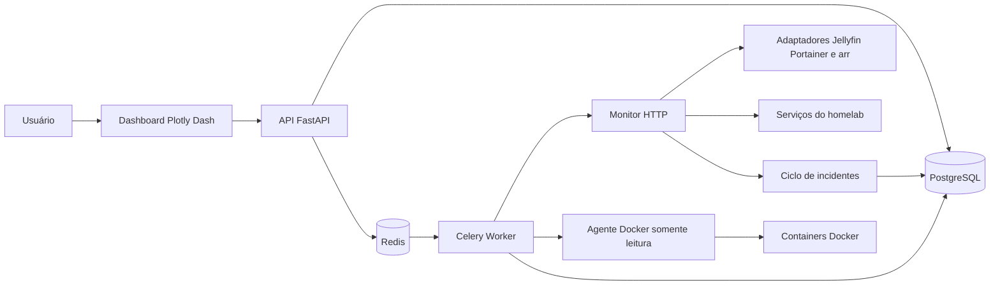

# Arquitetura planejada

## Responsabilidades

- **FastAPI:** autenticação, regras de acesso, cadastro e consulta de recursos.
- **PostgreSQL:** usuários, servidores, serviços, métricas e incidentes.
- **Redis/Celery:** fila e execução periódica das verificações.
- **Monitor HTTP:** disponibilidade, latência e código de resposta.
- **Adaptadores de integração:** consultam endpoints próprios do Jellyfin, Portainer e stack *arr e normalizam os metadados permitidos.
- **Ciclo de incidentes:** abre um incidente na primeira falha, evita duplicidade enquanto ele está aberto e o resolve na recuperação do serviço.
- **Agente Docker:** coleta somente leitura do estado e do consumo dos containers.
- **Plotly Dash:** serviço web separado que autentica pela API e visualiza apenas os indicadores do usuário atual.

## Isolamento dos dados

Cada servidor possui um proprietário e cada serviço pertence a um servidor. Todas as consultas autenticadas aplicam o identificador do usuário. Assim, uma conta não consegue listar, consultar, alterar ou excluir recursos de outra. A API retorna `404` nesses casos para não confirmar a existência do recurso.

## Autenticação e autorização

As senhas são armazenadas somente como hashes Argon2. Após o login, a API emite um JWT com validade configurável. Rotas privadas validam o token e carregam o usuário diretamente do banco. O cadastro público sempre cria contas comuns; ações administrativas exigem o perfil `admin`, criado por um comando executado no servidor.

## Segurança do Docker

O socket Docker não é exposto diretamente à aplicação web. O agente acessa um proxy interno com somente os endpoints de leitura necessários e `POST=0`. O proxy não publica portas no host. O agente exige token Bearer, escuta apenas no loopback por padrão e pode ser disponibilizado por uma VPN privada. Tokens são recebidos por variáveis de ambiente e nunca versionados.

## Credenciais das integrações

Cada credencial pertence diretamente a um serviço e só pode ser criada, consultada ou removida pelo proprietário desse serviço. A chave da API é criptografada com Fernet antes da persistência. A API informa somente se existe uma credencial e quando ela foi atualizada, sem devolver o valor original ou o texto cifrado.

O segredo `CREDENTIAL_ENCRYPTION_SECRET` deve ser diferente do `JWT_SECRET`, permanecer fora do repositório e ser mantido estável entre reinicializações. Os adaptadores enviam a chave apenas ao endereço configurado pelo usuário e persistem uma lista limitada de metadados técnicos, nunca a resposta completa do serviço externo.

## Processamento assíncrono

O Celery Beat publica periodicamente a tarefa de monitoramento no Redis. Um worker consulta somente os serviços habilitados, executa cada verificação e persiste o resultado e a eventual transição do incidente na mesma transação. Worker e Beat não publicam portas externas.

## Dashboard e privacidade

O dashboard não acessa o banco diretamente. Ele autentica na API, mantém o JWT na sessão do navegador e envia esse token ao consultar os indicadores. A API aplica o proprietário aos servidores, serviços, verificações e incidentes antes de calcular totais e séries. Assim, nenhum gráfico combina dados de contas diferentes.
